  
  &nbsp;
  

 

Consenteo builds websites, mobile apps, custom systems and AI agents, connects them to the platforms you already run, and engineers privacy into all of it. Consent is where we started. Today we deliver the whole digital stack, designed to work as **one connected system**.

 

##  &nbsp;Where growth stalls

Most businesses do not lack software. They lack software that **fits how they work**, that is **connected**, that their people **actually use**, and that can **act** rather than simply store information.

<table>
  <tr>
    <th align="left" width="42%">Where it stalls</th>
    <th align="left">What we put in its place</th>
  </tr>
  <tr>
    <td><b>Off-the-shelf tools that do not fit</b></td>
    <td>Custom systems shaped around your process, with no workarounds or unused modules.</td>
  </tr>
  <tr>
    <td><b>Disconnected systems</b></td>
    <td>CRM, ERP, accounting and WhatsApp integrated, so nothing is re-keyed by hand.</td>
  </tr>
  <tr>
    <td><b>Field teams that do not log activity</b></td>
    <td>Voice-first apps and agents that record visits and follow-ups for them.</td>
  </tr>
  <tr>
    <td><b>Work happens on mobile, systems do not</b></td>
    <td>iOS and Android apps for customers, staff and field teams, on the same live data.</td>
  </tr>
  <tr>
    <td><b>Websites that do not convert</b></td>
    <td>Conversion-led sites where every enquiry reaches the CRM in minutes, not days.</td>
  </tr>
  <tr>
    <td><b>Marketing without attribution</b></td>
    <td>Server-side tracking and consent-aware measurement that tie spend to closed revenue.</td>
  </tr>
  <tr>
    <td><b>AI that never reaches operations</b></td>
    <td>Agents with access to live systems that take action, not chatbots that only answer.</td>
  </tr>
  <tr>
    <td><b>Rising customer expectations</b></td>
    <td>Bilingual WhatsApp and voice agents that respond instantly, around the clock.</td>
  </tr>
</table>

 

##  &nbsp;One system, eight service lines

Each line can be commissioned on its own, but they are designed to work together: the website and apps feed the core system, the core system feeds marketing, AI operates across all of them, and consent governs the whole stack.

<picture>
  <source media="(prefers-color-scheme: dark)" srcset="assets/system-map-dark.svg" />
  
</picture>

<table>
  <tr>
    <td width="50%" valign="top">
      <b>BUILD</b> 
      <b>Websites and digital platforms</b> 
      Corporate sites, e-commerce, booking platforms and customer portals. Conversion-led and integrated from day one: forms route to the CRM, payments to accounting, analytics to one reporting layer. Bilingual Arabic and English with full right-to-left support.
    </td>
    <td width="50%" valign="top">
      <b>BUILD</b> 
      <b>Mobile applications</b> 
      Native or cross-platform iOS and Android apps for e-commerce and loyalty, booking, on-demand services, field sales and service, delivery and internal staff use. Offline capability, push notifications and in-app payments as standard options.
    </td>
  </tr>
  <tr>
    <td valign="top">
      <b>BUILD</b> 
      <b>Custom systems</b> 
      Software shaped around your process rather than the reverse: web applications, CRM, ERP, portals, dashboards, booking, inventory and operations platforms. Role-based access, reporting, and full ownership of the code and data.
    </td>
    <td valign="top">
      <b>CONNECT</b> 
      <b>System integration</b> 
      Vendor connectors where they exist, custom APIs and middleware where they do not. CRM, ERP, accounting, payment gateways, WhatsApp Business, telephony and legacy systems never designed to talk to each other.
    </td>
  </tr>
  <tr>
    <td valign="top">
      <b>AUTOMATE</b> 
      <b>AI and custom agents</b> 
      Agents that act inside your systems by voice or chat: they update records, create tasks, book meetings, draft documents and trigger workflows across web, mobile and WhatsApp.
    </td>
    <td valign="top">
      <b>COMPLY</b> 
      <b>Consent and privacy</b> 
      As Consent Management Platform partners, we engineer privacy and compliance at system level across websites, apps and back-office systems, not as a banner added on top.
    </td>
  </tr>
  <tr>
    <td valign="top">
      <b>GROW</b> 
      <b>Digital marketing</b> 
      Performance campaigns across search, social and marketplaces, backed by server-side tracking, consent-aware measurement and end-to-end attribution. Lead nurturing by email and WhatsApp, reported against closed revenue rather than clicks.
    </td>
    <td valign="top">
      <b>SUSTAIN</b> 
      <b>Support and evolution</b> 
      Retained engineering support, monitoring and continuous improvement after launch, including app store releases, new features and integration maintenance. Documentation and handover on every project.
    </td>
  </tr>
</table>

 

##  &nbsp;AI that takes action

We do not build isolated chatbots. We build agents that **do the work** inside live systems, safe by design: they operate within role permissions, log every action they take, and ask for confirmation before anything irreversible.

<picture>
  <source media="(prefers-color-scheme: dark)" srcset="assets/agent-dark.svg" />
  
</picture>

<table>
  <tr>
    <td width="33%" valign="top">
      <b>01 · BUILT IN</b> 
      <b>Inside the systems we deliver</b> 
      Document reading and data extraction, call and meeting summaries, search across company knowledge, and quotes, emails and reports drafted from live data.
    </td>
    <td width="33%" valign="top">
      <b>02 · PURPOSE-BUILT</b> 
      <b>Custom agents</b> 
      Designed around a specific role or process. People speak or type naturally, in English or Arabic, on web, mobile, WhatsApp or voice.
    </td>
    <td width="33%" valign="top">
      <b>03 · ON WHAT YOU OWN</b> 
      <b>An AI layer on existing systems</b> 
      Conversational access, reporting and automation on top of the CRM and ERP you already run, without replacing them.
    </td>
  </tr>
</table>

| Team | What the agent does in live operations |
| :--- | :--- |
| **Sales** | Logs visits, updates deals, prepares quotes and schedules follow-ups from a short voice note. |
| **Customer service** | Answers, qualifies and resolves enquiries on WhatsApp and web in both languages, then hands over with full context. |
| **Operations** | Creates work orders, checks stock, assigns jobs and reports progress in plain language. |
| **Finance** | Reads invoices and receipts, matches them to orders and flags exceptions for review. |
| **Management** | Answers questions about live company data with summaries and reports on demand. |
| **HR and admin** | Handles leave requests, onboarding steps and internal policy questions. |

 

##  &nbsp;Privacy, built in at system level

Consent is where we started. Most compliance programmes stop at a policy document and a cookie banner, leaving exposure in tags that fire before consent, apps that ignore the user's choice, and measurement that collapses after a decline. We fix it in the technology itself.

<picture>
  <source media="(prefers-color-scheme: dark)" srcset="assets/consent-dark.svg" />
  
</picture>

- **CMP selection and setup.** Rollout across websites and apps with bilingual banners, geo-targeted rules and audit-ready consent records.
- **Consent across the stack.** The user's choice reaches tags, analytics, ad platforms, mobile SDKs, the CRM and marketing automation, so nothing fires without a lawful basis.
- **Measurement that survives.** Advanced Consent Mode v2 and server-side tracking keep reporting and conversion modelling accurate.
- **Data mapping and rights.** Personal data flows, retention rules, and access, correction and deletion requests handled inside your systems.
- **One configuration, many regulations.** UAE PDPL, DIFC, ADGM, GDPR, UK GDPR and US state laws, with periodic re-testing so the setup does not drift.

 

##  &nbsp;Built for the region

Our home market is mobile-first and WhatsApp-first, with a bilingual workforce and fast-moving regulation. The solutions we are asked for most reflect that.

<table>
  <tr>
    <td width="50%" valign="top"><b>Bilingual WhatsApp and voice agents</b> Arabic and English agents that qualify enquiries, book appointments and hand over to staff with context, around the clock.</td>
    <td width="50%" valign="top"><b>Lead engines</b> Leads from portals, campaigns and the website captured in one CRM, routed instantly and followed up automatically.</td>
  </tr>
  <tr>
    <td valign="top"><b>E-invoicing and ERP readiness</b> ERP and accounting integration with AI-assisted invoice processing and data extraction.</td>
    <td valign="top"><b>Voice-first field service apps</b> Field sales, maintenance and logistics teams report and update jobs by voice, in either language.</td>
  </tr>
  <tr>
    <td valign="top"><b>Concierge and loyalty</b> Reservation agents for hospitality and branded iOS and Android loyalty apps for retail and F&amp;B groups.</td>
    <td valign="top"><b>ERP for multi-entity groups</b> Operations platforms for groups with several brands, branches or entities, with consolidated reporting and AI on top.</td>
  </tr>
</table>

 

##  &nbsp;How we engage

Work begins with a defined problem rather than a technology choice. Each stage can be commissioned on its own, and none commits you to the next.

<picture>
  <source media="(prefers-color-scheme: dark)" srcset="assets/engage-dark.svg" />
  
</picture>

<table>
  <tr>
    <td width="50%" valign="top"><b>One connected operation</b> Website, apps, marketing, CRM and back office share the same data, so every team works from one accurate view of the customer.</td>
    <td width="50%" valign="top"><b>Systems people actually use</b> Voice and chat remove the data-entry burden, the most common reason business systems are not adopted.</td>
  </tr>
  <tr>
    <td valign="top"><b>Built for the region</b> Bilingual by design, WhatsApp-native, and aligned with local and international privacy regulations.</td>
    <td valign="top"><b>Ownership and flexibility</b> You own the code and data of every custom system we build. Where existing systems are sound, we extend them rather than replace them.</td>
  </tr>
</table>

 

  
    <a href="https://consenteo.com">consenteo.com</a> &nbsp;·&nbsp;
    <a href="https://consenteo.com/contact">Contact</a> &nbsp;·&nbsp;
    <a href="https://consenteo.com/free-audit">Free consent audit</a>
  

